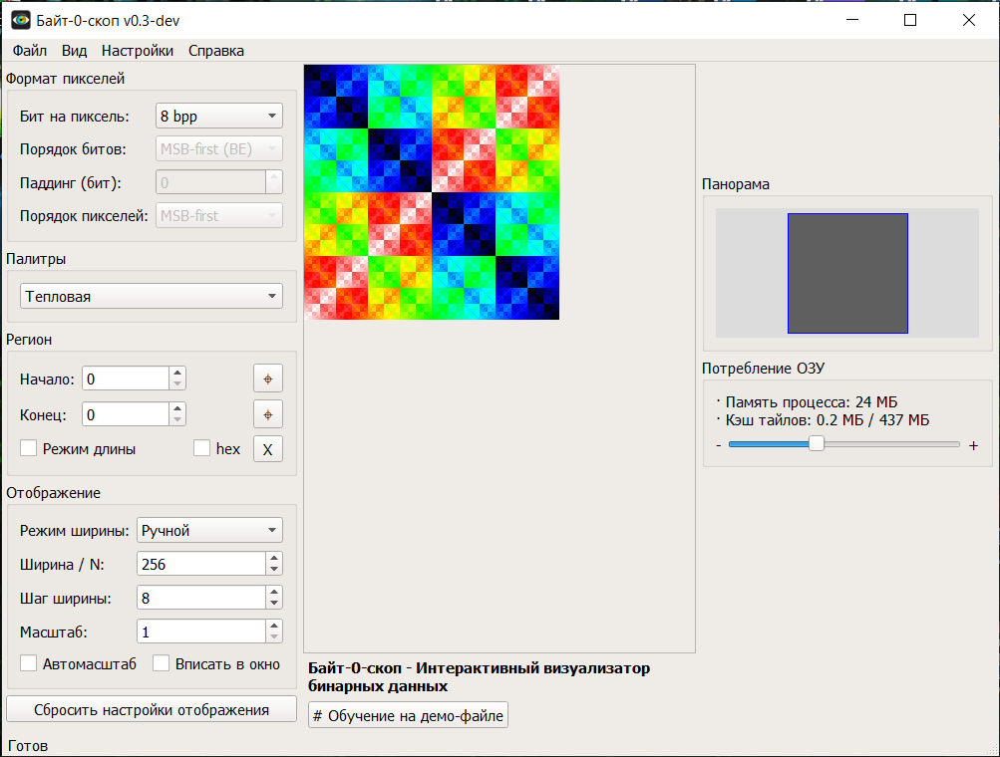

# Byte-0-scope / Байт-0-скоп — визуализатор бинарных данных

Интерактивное представление произвольных файлов в виде изображения:
каждый байт (или бит, или многобайтовый пиксель) — точка на холсте.
Помогает «увидеть» структуру данных: заголовки, палитры, спрайты,
сжатые блоки, паддинг.

Автор: pav13, 2026.

Разработка: часть кода подготовлена с помощью ИИ-ассистента (DeepSeek).

## Скриншоты

<p align="center">
  
</p>

## Возможности

- Открытие файлов любого размера (от килобайт до гигабайт): mmap для больших, `QByteArray` для небольших — переключается в настройках
- Битовые форматы: 1 / 2 / 3 / 4 / 8 bpp с настраиваемым порядком битов (MSB/LSB) и паддингом строк
- Многобайтовые форматы: RGB, BGR, GBR, BRG, GRB, RBG, RGBA, ARGB, BGRA, ABGR, RGB565, BGR565, RGB555, ARGB1555, Integer 16/32/64, Float 32/64
- Палитры: 60+ встроенных (серые, тепловые, виридис, плазма, радуга, HSV, Game Boy, CGA, EGA, C64, ZX Spectrum, терминальные и др.)
- Конфигурируемые палитры: порог, полосы энтропии, битовая плоскость, повторы, пользовательские диапазоны, «из файла»
- Специальные палитры: частота байтов, подсветка повторов
- Масштабирование (1–32×), панорамирование, панорамный обзор с миниатюрой
- Тайловый рендеринг с LRU-кэшем, prefetching соседних тайлов, настраиваемый размер тайла и лимит кэша
- Информационная панель с детализацией байта (hex/dec/bin/ASCII) и пикселя (для многобайтовых форматов)
- Режимы ширины: ручной, авто (1:1), степень 2, 16:9, 4:3, «байт в строке», ближайшее «круглое», делитель ≤ N
- Регион: начало / конец / длина, выбор ЛКМ по холсту, режим «длина»
- Экспорт в PNG, в том числе с учётом downsampling
- Сравнение двух файлов через XOR с подсветкой различий
- Зеркальное отражение по горизонтали и вертикали
- Тёмная и светлая темы
- Список недавних файлов, drag & drop, открытие из командной строки
- Режим «Обучение»: встроенный demo-файл со скрытой структурой, которую нужно восстановить подбором настроек
- Локализация интерфейса: русский

### Drag & Drop

| Расширение | Действие |
|---|---|
| любой файл | открытие как источник данных |
| `.b0s` | открытие парного файла данных с загрузкой настроек отображения |

### Файлы настроек

**Глобальные настройки** — `byte0scope-settings.ini`:

- тема, язык, геометрия окна (в т.ч. maximized / fullscreen)
- режим загрузки (mmap / в память)
- производительность: размер тайла, лимит кэша, prefetch
- последние файлы, последняя папка
- значения по умолчанию для новых файлов (bpp, порядок битов, палитра, ширина, масштаб и т.д.)

Файл хранится рядом с исполняемым файлом; если каталог недоступен для записи —
в пользовательском каталоге конфигурации (`QStandardPaths::AppConfigLocation`).
Приоритет: portable (рядом с exe) → appdata.

**Настройки отображения** — `<имя_файла>.b0s`:

- bpp и порядок битов / пикселей / паддинг
- палитра и её параметры
- режим ширины, ширина, шаг
- масштаб, автомасштаб, вписать в окно
- регион (offset / length / length_mode)
- зеркала по горизонтали и вертикали

Формат — JSON (UTF-8), хранится рядом с исходным файлом и подхватывается
автоматически при открытии. Пиксели в `.b0s` не дублируются — источник
истины сам файл данных.

### Управление

| Действие | Что делает |
|---|---|
| ЛКМ по пикселю | закрепить байт (повторный ЛКМ — снять) |
| ПКМ + перемещение | панорамирование |
| Колесо | масштаб |
| Ctrl + колесо | ширина строки (в ручном режиме) |
| Ctrl+O | открыть файл |
| Ctrl+S | сохранить `.b0s` рядом с файлом |
| Ctrl+L | загрузить `.b0s` |
| Ctrl+R | сбросить настройки отображения |
| Ctrl+E | экспорт в PNG |
| Ctrl+X | сравнить два файла (XOR) |
| Ctrl+W | закрыть текущий файл |
| Drag & drop | открыть файл перетаскиванием |

### Ассоциации файлов

Меню «Настройки»:

- `Ассоциировать .b0s с этой программой` — `.b0s` открывается в Byte-0-scope
- `Удалить ассоциацию .b0s`.

<details>
<summary><sub>Формат .b0s (JSON)</sub></summary>

Пример:

```json
{
    "bpp_mode": 8,
    "bit_order": "msb",
    "pixel_order": "msb",
    "row_padding_bits": 0,
    "scale": 1,
    "width_mode": "fixed",
    "fixed_width": 256,
    "width_step": 8,
    "bytes_per_row": 16,
    "auto_scale": false,
    "fit_to_window": false,
    "offset": 0,
    "length": 0,
    "length_mode": false,
    "mirror_horizontal": false,
    "mirror_vertical": false,
    "palette": "heat",
    "palette_params": {
        "threshold": { "threshold": 64 }
    }
}
```

Неизвестные ключи игнорируются; отсутствующие — берутся из значений
по умолчанию. При открытии `.b0s`-файла в качестве аргумента командной
строки (или через ассоциацию) рядом ищется файл данных без суффикса
`.b0s`; если его нет — выводится предупреждение.

</details>

## Сборка

Используется **C++11 + Qt 5.6.3** (Core, Gui, Widgets), статическая сборка Qt,
MinGW 4.9.2 32-bit, CMake ≥ 3.5.

### Скрипты (Windows)

```
scripts\build.bat         инкрементальная сборка -> byte-0-scope.exe
scripts\clean-build.bat   удалить build\ и пересобрать
scripts\release.bat       собрать releases\byte-0-scope-v<ver>\
```

Все скрипты используют локальную папку `qt-5.6.3-static\` в корне
репозитория (в git не входит).

### Вручную

```bat
cmake -S . -B build -G "MinGW Makefiles" ^
      -DCMAKE_PREFIX_PATH=qt-5.6.3-static ^
      -DBS_QT_DIR=qt-5.6.3-static ^
      -DCMAKE_BUILD_TYPE=Release
cmake --build build -j4
```

## Структура репозитория

```
CMakeLists.txt          сборка
version.txt             версия (используется в APP_VERSION и release.bat)
src/                    исходники (C++/Qt)
src/resources/          .qrc и .rc (иконки, переводы)
scripts/                bat-скрипты сборки и релиза
scripts/BUILD-QT.md     как собрать используемую статическую Qt
```

## Лицензия

GPL-3.0-or-later. См. [LICENSE](LICENSE).

Лицензия выбрана потому, что бинарник статически линкуется с Qt, собранной
под GPL (`-opensource`).