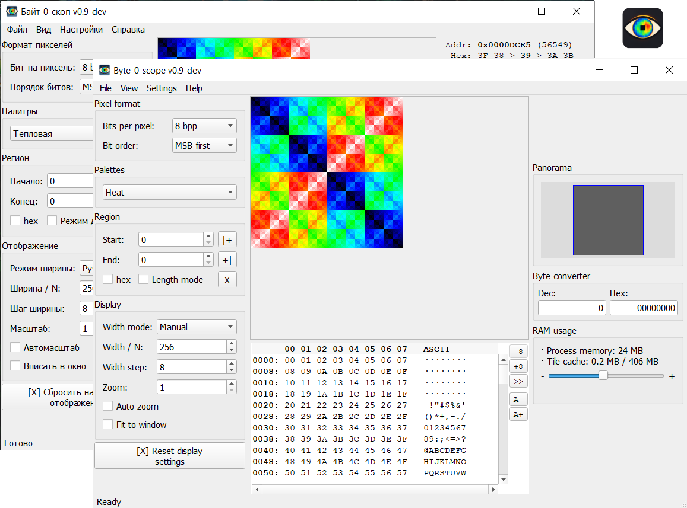

# Byte-0-scope — binary data visualizer

[English](README.md) | [Русский](README.ru.md)

Interactive representation of arbitrary files as an image:
each byte (or bit, or multi-byte pixel) is a point on a canvas.
Helps to "see" the structure of data: headers, palettes, sprites,
compressed blocks, padding.

Author: pav13, 2026.

Development: part of the code was prepared with the help of an AI assistant (DeepSeek).

GitHub: https://github.com/pav1388/byte-0-scope

Forum: https://www.emu-land.net/forum/index.php/topic,93496.0.html

## Screenshots

<p align="center">
  
</p>

## Features

- Opening files of any size (from kilobytes to gigabytes): mmap for large files, `QByteArray` for small ones — switchable in settings
- Bit formats: 1 / 2 / 3 / 4 / 8 bpp with configurable bit order (MSB/LSB) and row padding
- Multi-byte formats: RGB, BGR, GBR, BRG, GRB, RBG, RGBA, ARGB, BGRA, ABGR, RGB565, BGR565, RGB555, ARGB1555, Integer 16/32/64, Float 32/64
- Palettes: 60+ built-in (grayscale, heat, viridis, plasma, rainbow, HSV, Game Boy, CGA, EGA, C64, ZX Spectrum, terminal, and others)
- Configurable palettes: threshold, entropy bands, bit plane, repeats, custom ranges, "from file"
- Special palettes: byte frequency, repeat highlighting
- Zoom (1–32×), panning, panoramic overview with a thumbnail
- Tile rendering with LRU cache, prefetching of neighboring tiles, configurable tile size and cache limit
- Information panel with byte details (hex/dec/bin/ASCII) and pixel details (for multi-byte formats)
- Width modes: manual, auto (1:1), power of 2, 16:9, 4:3, "bytes per row", nearest "round", divisor ≤ N
- Region: start / end / length, selection with LMB on the canvas, "length" mode
- Export to PNG, including with downsampling
- Comparing two files via XOR with difference highlighting
- Mirroring horizontally and vertically
- Dark and light themes
- Recent files list, drag & drop, opening from the command line
- "Learning" mode: a built-in demo file with a hidden structure that must be recovered by trying different settings
- Interface localization: Russian, English

### Drag & Drop

| Extension | Action |
|---|---|
| any file | open as a data source |
| `.b0s` | open the paired data file with display settings loaded |

### Settings files

**Global settings** — `byte0scope-settings.ini`:

- theme, language, window geometry (including maximized / fullscreen)
- load mode (mmap / into memory)
- performance: tile size, cache limit, prefetch
- recent files, last folder
- default values for new files (bpp, bit order, palette, width, zoom, etc.)

The file is stored next to the executable; if the directory is not writable —
in the user configuration directory (`QStandardPaths::AppConfigLocation`).
Priority: portable (next to exe) → appdata.

**Display settings** — `<file_name>.b0s`:

- bpp and bit / pixel order / padding
- palette and its parameters
- width mode, width, step
- zoom, auto-zoom, fit to window
- region (offset / length / length_mode)
- horizontal and vertical mirrors

Format — JSON (UTF-8), stored next to the source file and picked up
automatically when opening. Pixels are not duplicated in `.b0s` — the
data file itself is the source of truth.

### Controls

| Action | What it does |
|---|---|
| LMB on a pixel | pin the byte (LMB again — unpin) |
| RMB + drag | panning |
| Wheel | zoom |
| Ctrl + wheel | row width (in manual mode) |
| Ctrl+O | open file |
| Ctrl+S | save `.b0s` next to the file |
| Ctrl+L | load `.b0s` |
| Ctrl+R | reset display settings |
| Ctrl+E | export to PNG |
| Ctrl+X | compare two files (XOR) |
| Ctrl+W | close the current file |
| Drag & drop | open a file by dragging it |

### File associations

"Settings" menu:

- `Associate .b0s with this program` — `.b0s` opens in Byte-0-scope
- `Remove .b0s association`.

<details>
<summary><sub>.b0s format (JSON)</sub></summary>

Example:

```json
{
    "bpp_mode": 8,
    "bit_order": "msb",
    "pixel_order": "msb",
    "row_padding_bits": 0,
    "scale": 1,
    "width_mode": "fixed",
    "fixed_width": 256,
    "width_step": 8,
    "bytes_per_row": 16,
    "auto_scale": false,
    "fit_to_window": false,
    "offset": 0,
    "length": 0,
    "length_mode": false,
    "mirror_horizontal": false,
    "mirror_vertical": false,
    "palette": "heat",
    "palette_params": {
        "threshold": { "threshold": 64 }
    }
}
```

Unknown keys are ignored; missing ones are taken from the default
values. When a `.b0s` file is opened as a command-line argument
(or via file association), the data file without the `.b0s` suffix is
looked up next to it; if it is not there — a warning is shown.

</details>

## Building

Uses **C++11 + Qt 5.6.3** (Core, Gui, Widgets), static Qt build,
MinGW 4.9.2 32-bit, CMake ≥ 3.5.

### Scripts (Windows)

```
scripts\build.bat         incremental build -> byte-0-scope.exe
scripts\clean-build.bat   delete build\ and rebuild
scripts\release.bat       build releases\byte-0-scope-v<ver>\
```

All scripts use the local `qt-5.6.3-static\` folder in the repository
root (not included in git).

### Manually

```bat
cmake -S . -B build -G "MinGW Makefiles" ^
      -DCMAKE_PREFIX_PATH=qt-5.6.3-static ^
      -DBS_QT_DIR=qt-5.6.3-static ^
      -DCMAKE_BUILD_TYPE=Release
cmake --build build -j4
```

## Repository structure

```
CMakeLists.txt          build
version.txt             version (used in APP_VERSION and release.bat)
src/                    sources (C++/Qt)
src/resources/          .qrc and .rc (icons, translations)
scripts/                bat scripts for build and release
scripts/BUILD-QT.md     how to build the static Qt used
```

## License

GPL-3.0-or-later. See [LICENSE](LICENSE).

The license was chosen because the binary is statically linked with Qt built
under GPL (`-opensource`).