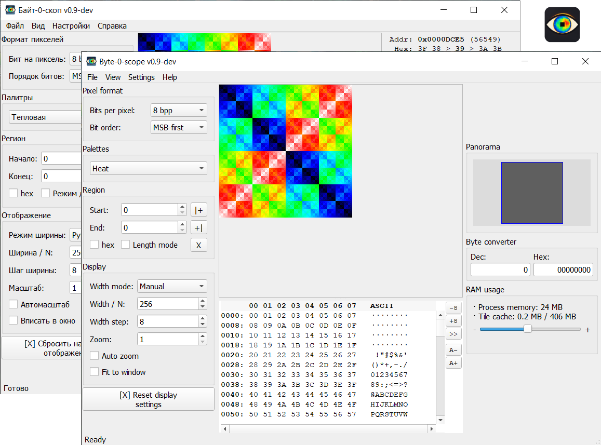

# Byte-0-scope / Байт-0-скоп - визуализатор бинарных данных

[English](README.md) | [Русский](README.ru.md)

Интерактивное представление произвольных файлов в виде изображения:
каждый байт (или бит, или многобайтовый пиксель) - точка на холсте.
Помогает «увидеть» структуру данных: заголовки, палитры, спрайты,
сжатые блоки, паддинг.

Автор: pav13.

Разработка: часть кода подготовлена с помощью ИИ-ассистента.

GitHub: https://github.com/pav1388/byte-0-scope

Форум: https://www.emu-land.net/forum/index.php/topic,93496.0.html

## Скриншоты

<p align="center">
  
</p>

## Возможности

- Открытие файлов любого размера (от килобайт до гигабайт): mmap для больших, `QByteArray` для небольших - переключается в настройках
- Битовые форматы: 1 / 2 / 3 / 4 / 8 bpp с настраиваемым порядком битов (MSB/LSB) и паддингом строк
- Многобайтовые форматы: RGB, BGR, GBR, BRG, GRB, RBG, RGBA, ARGB, BGRA, ABGR, RGB565, BGR565, RGB555, ARGB1555, Integer 16/32/64, Float 32/64
- Палитры: 90+ встроенных (серые, тепловые, виридис, плазма, радуга, терминальные и др.)
- Конфигурируемые палитры: порог, полосы энтропии, битовая плоскость, нули-единицы, пользовательская, «из файла»
- Специальные палитры: частота байтов, подсветка повторов
- Масштабирование (1-32x), панорамирование, панорамный обзор с миниатюрой
- Тайловый рендеринг с LRU-кэшем, prefetching соседних тайлов, настраиваемый размер тайла и лимит кэша
- Информационная панель с детализацией байта (hex/dec/bin/ASCII) и пикселя (для многобайтовых форматов)
- Всплывающая подсказка с деталями байта рядом с курсором (включается в настройках)
- Hex-просмотр: байты + ASCII + адреса
- Конвертер Dec/Hex (0 … 0xFFFFFFFF) в правой панели
- Панель отладочной информации (включается в настройках)
- Режимы ширины: ручной, авто (1:1), степень 2, 16:9, 4:3, «байт в строке», ближайшее «круглое», делитель ≤ N
- Регион: начало / конец / длина, выбор ЛКМ по холсту, режим «длина», hex-режим ввода
- Экспорт в PNG в трёх режимах: текущая видимая область, всё изображение 1:1, всё изображение в текущем масштабе
- Сравнение двух файлов через XOR с подсветкой различий и процентом отличий
- Зеркальное отражение по горизонтали и вертикали
- Тёмная и светлая темы
- Список недавних файлов, drag & drop, открытие из командной строки
- Режим «Обучение»: встроенный demo-файл со скрытой структурой, которую нужно восстановить подбором настроек
- Локализация интерфейса: русский, английский

### Drag & Drop

| Расширение | Действие |
|---|---|
| любой файл | открытие как источник данных |
| `.b0s` | открытие парного файла данных с загрузкой настроек отображения |

Если перетащить сразу два и более файлов - первые два загружаются в режим XOR-сравнения.

### Файлы настроек

**Глобальные настройки** - `byte0scope-settings.ini`:

- тема, язык, геометрия окна
- режим загрузки (mmap / в память)
- производительность: размер тайла, лимит кэша, prefetch
- последние файлы, последняя папка
- значения по умолчанию для новых файлов (bpp, порядок битов, палитра, ширина, масштаб и т.д.)
- всплывающая подсказка байта (`byte_tooltip`), панель отладки (`show_debug_info`)
- состояние hex-просмотра: видимость, высота, байтов-в-строке, размер шрифта

Файл хранится рядом с исполняемым файлом, если каталог недоступен для записи -
в пользовательском каталоге конфигурации.

**Настройки отображения** - `<имя_файла>.b0s`:

- bpp и порядок битов / пикселей / паддинг
- палитра и её параметры
- режим ширины, ширина, шаг
- масштаб
- регион (offset / length / length_mode)
- зеркала по горизонтали и вертикали

Формат - JSON (UTF-8), хранится рядом с исходным файлом и подхватывается
автоматически при открытии. Пиксели в `.b0s` не дублируются - источник
истины сам файл данных.

### Управление

| Действие | Что делает |
|---|---|
| ЛКМ по пикселю | закрепить байт (повторный ЛКМ - снять) |
| ПКМ + перемещение | панорамирование |
| Колесо | масштаб (кроме режимов «Fit to window» / «Auto zoom») |
| Ctrl + колесо | ширина строки; при необходимости автоматически переключает режим ширины в «ручной» |
| ЛКМ в hex-просмотре | выбрать байт и синхронизировать с холстом |
| Перетаскивание верхнего края hex-просмотра | изменение высоты панели |
| Кнопки «\|+\|» / «+\|» в панели Region | выбор начала / конца региона кликом по холсту |
| Ctrl+O | открыть файл |
| Ctrl+S | сохранить `.b0s` рядом с файлом |
| Ctrl+L | загрузить `.b0s` |
| Ctrl+R | сбросить настройки отображения |
| Ctrl+E | экспорт в PNG (всё изображение 1:1) |
| Ctrl+X | сравнить два файла (XOR) |
| Ctrl+W | закрыть текущий файл |
| Drag & drop | открыть файл перетаскиванием |


### Ассоциации файлов

Меню «Настройки»:

- `Ассоциировать .b0s с этой программой` - `.b0s` открывается в Byte-0-scope
- `Удалить ассоциацию .b0s`.

<details>
<summary><sub>Формат .b0s (JSON)</sub></summary>

Пример:

```json
{
    "bpp_mode": 8,
    "bit_order": "msb",
    "pixel_order": "msb",
    "row_padding_bits": 0,
    "scale": 1,
    "width_mode": "fixed",
    "fixed_width": 256,
    "width_step": 8,
    "bytes_per_row": 16,
    "auto_scale": false,
    "fit_to_window": false,
    "offset": 0,
    "length": 0,
    "length_mode": false,
    "mirror_horizontal": false,
    "mirror_vertical": false,
    "palette": "heat",
    "palette_params": {
        "threshold": { "threshold": 64 }
    }
}
```

Неизвестные ключи игнорируются; отсутствующие - берутся из значений
по умолчанию. При открытии `.b0s`-файла в качестве аргумента командной
строки (или через ассоциацию) рядом ищется файл данных без суффикса
`.b0s`; если его нет - выводится предупреждение.

</details>

## Сборка

C++11, статическая Qt (Core, Gui, Widgets), CMake ≥ 3.5.
Поддерживаются два профиля сборки:

| Профиль | Qt        | Toolchain             | Назначение                              |
|---------|-----------|-----------------------|-----------------------------------------|
| `xp32`  | 5.6.3     | MinGW 4.9.2, 32-bit   | совместимость с Windows XP              |
| `win64` | 5.15.2    | MinGW 8.1.0, 64-bit   | современные 64-битные Windows           |

Для каждого профиля в `scripts\` есть одинаковый набор bat-скриптов
(`<profile>` - `xp32` или `win64`):

```
build-<profile>.bat                инкрементальная сборка -> byte-0-scope.exe
clean-build-<profile>.bat          удалить build\ и пересобрать
release-<profile>.bat              собрать releases\byte-0-scope-v<ver>\
translations-update-<profile>.bat  обновить .ts (lupdate) и собрать .qm
translations-release-<profile>.bat переводы, готовые для релиза
```

`scripts\_build-menu.bat` - меню для запуска этих действий.

Каталоги со статическими сборками Qt (`qt-5.6.3-static\`, `qt-5.15.2-static\`)
кладутся в корень репозитория и в git не входят. Как их собрать - см.
`scripts/BUILD-QT-5.6.3-static.md` и `scripts/BUILD-QT-5.15.2-static.md`.

Ручная сборка (пример для win64; для xp32 меняются имена каталогов):

```bat
cmake -S . -B build-win64 -G "MinGW Makefiles" ^
      -DCMAKE_PREFIX_PATH=qt-5.15.2-static ^
      -DBS_QT_DIR=qt-5.15.2-static ^
      -DCMAKE_BUILD_TYPE=Release
cmake --build build-win64 -j4
```

## Структура репозитория

```
CMakeLists.txt          сборка
version.txt             версия (используется в APP_VERSION и release-*.bat)
src/                    исходники (C++/Qt)
src/resources/          .qrc и .rc (иконки, переводы)
scripts/                bat-скрипты сборки, релиза и переводов
scripts/_build-menu.bat меню сборки
scripts/BUILD-QT-*.md   как собрать используемые статические Qt
```

## Лицензия

GPL-3.0-or-later. См. [LICENSE](LICENSE).

Лицензия выбрана потому, что бинарник статически линкуется с Qt, собранной
под GPL (`-opensource`).